# Отчёт по лабораторной работе № 1 — C++

Министерство Образования Российской Федерации

Пермский Государственный Национальный Исследовательский университет

Государственного и муниципального управления

**Отчет по Лабораторной работе №1**

**по дисциплине:**

**«Язык программирования C++»**

> Выполнил студент ИТ-5, 2 курс
>
> Кудряшов Иван
>
> Руководитель Ракина В.Д.

г. Пермь, 2026

**Задание 1**

*Задача 2. Сумма знаков*

Текст задачи

*Дана сигнатура функции: int sumLastNums(int x);*

*Необходимо реализовать функцию таким образом, чтобы она возвращала
результат сложения двух последних знаков числа, предполагая, что знаков
в числе не менее двух.*

Пример:

x = 4568 → результат: 14

*Алгоритм решения*

1.  Проверить, что введённое число содержит не менее двух цифр (\|x\|
    \>= 10). Если нет — вывести сообщение об ошибке.

2.  Взять модуль числа, чтобы работать с цифрами независимо от знака.

3.  Найти остаток от деления на 100 — это две последние цифры.

4.  Выделить первую из двух последних цифр: разделить остаток на 10.

5.  Выделить вторую цифру: взять остаток от деления на 10.

6.  Сложить полученные цифры и вернуть результат.

*Тестирование*

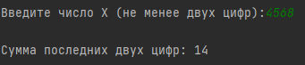

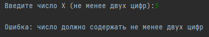  
  
  
*Тесты подтверждают работу всех веток алгоритма:*

4568: сумма последних цифр (6+8) = 14.

123: сумма последних цифр (2+3) = 5.

5: корректный вывод ошибки для однозначного числа.

*Задача 4. Есть ли позитив*

Текст задачи

*Дана сигнатура функции: bool isPositive(int x);*

*Необходимо реализовать функцию таким образом, чтобы она принимала число
x и возвращала true, если оно положительное.*

Пример 1: x = 3 → true

Пример 2: x = -5 → false

*Алгоритм решения*

1.  Считать число x.

2.  Вернуть результат сравнения x \> 0.

*Тестирование*

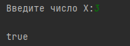*Тесты подтверждают
корректную работу:* 3 (true), -5 (false) и граничный случай 0 (false).

*Задача 6. Большая буква*

Текст задачи

*Дана сигнатура функции: bool isUpperCase(char x);*

*Необходимо реализовать функцию таким образом, чтобы она принимала
символ x и возвращала true, если это большая буква в диапазоне от ‘A’ до
‘Z’.*

Пример 1: x = ‘D’ → true

Пример 2: x = ‘q’ → false

*Алгоритм решения*

1.  Считать символ x.

2.  Проверить, находится ли символ в диапазоне от 'A' до 'Z'.

3.  Вернуть true, если условие выполнено, иначе false.

*Тестирование*

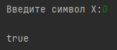*Проверены случаи:* заглавная
буква (true), строчная буква (false) и символ вне диапазона A–Z (false).

*Задача 8. Делитель*

Текст задачи

*Дана сигнатура функции: bool isDivisor(int a, int b);*

*Необходимо реализовать функцию таким образом, чтобы она возвращала
true, если любое из принятых чисел делит другое нацело.*

Пример 1: a = 3, b = 6 → true

Пример 2: a = 2, b = 15 → false

*Алгоритм решения*

1.  Считать числа a и b.

2.  Если a == 0 или b == 0, вернуть false (на ноль делить нельзя).

3.  Проверить, делится ли b на a нацело (b % a == 0).

4.  Проверить, делится ли a на b нацело (a % b == 0).

5.  Если хотя бы одно условие истинно, вернуть true, иначе false.

*Тестирование*

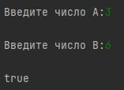

*Проверены все случаи:* делимость (3, 6), отсутствие делимости (2, 15) и
деление на ноль (0, 5).

*Задача 10. Многократный вызов*

Текст задачи

*Дана сигнатура функции: int lastNumSum(int a, int b);*

*Необходимо реализовать функцию таким образом, чтобы она считала сумму
цифр двух чисел из разряда единиц. Выполните с его помощью
последовательное сложение пяти чисел и результат выведите на экран.
Постарайтесь выполнить задачу, используя минимально возможное количество
вспомогательных переменных.*

Пример:

5+11 это 6

6+123 это 9

9+14 это 13

13+1 это 4

Итого 4

*Алгоритм решения*

1.  Считать пять целых чисел.

2.  Вызвать lastNumSum для первых двух чисел: result = lastNumSum(num1,
    num2).

3.  Последовательно для оставшихся трёх чисел: result =
    lastNumSum(result, num3), затем с num4, затем с num5.

4.  Вывести итоговый результат.

5.  Функция lastNumSum(a, b) возвращает (\|a\| % 10) + (\|b\| % 10).

*Тестирование*

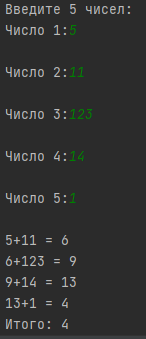

*Тесты подтверждают последовательное накопление результата:* сумма
последних цифр каждой пары передаётся в следующий вызов. Итог: 4.

**Задание 2**

*Задача 2. Безопасное деление*

Текст задачи

*Дана сигнатура функции: double safeDiv(int x, int y);*

*Необходимо реализовать функцию, которая возвращает деление x на y и
гарантирует, что не возникнет ошибка деления на 0. При делении на 0
вернуть 0.*

Пример 1: x=5, y=0 → 0

Пример 2: x=8, y=2 → 4

*Алгоритм решения*

1.  Считать числа x и y.

2.  Если y == 0 — вернуть 0.

3.  Иначе вернуть результат (double)x / y.

4.  Вывести результат.

*Тестирование*

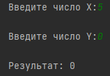

1.  5 и 0 → 0 (сработала защита от деления на ноль).

2.  8 и 2 → 4 (обычное деление).

*Задача 4. Строка сравнения*

Текст задачи

*Дана сигнатура функции: String makeDecision(int x, int y);*

*Функция возвращает строку, которая включает два числа и знак сравнения
(\>, \<, ==).*

Пример 1: x=5, y=7 → «5 \< 7»

Пример 2: x=8, y=-1 → «8 \> -1»

Пример 3: x=4, y=4 → «4 == 4»

*Алгоритм решения*

1.  Считать x и y.

2.  Если x \> y — вернуть строку "x \> y".

3.  Если x \< y — вернуть строку "x \< y".

4.  Иначе — вернуть строку "x == y".

5.  Вывести результат.

*Тестирование*

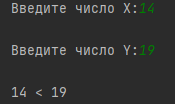

*Тесты охватывают все случаи сравнения:* меньше, больше и равно.
Формируемые строки соответствуют условию.

*Задача 6. Тройная сумма*

Текст задачи

*Дана сигнатура функции: bool sum3(int x, int y, int z);*

*Возвращает true, если любые два из трёх чисел можно сложить так, чтобы
получить третье.*

Пример 1: x=5, y=7, z=2 → true

Пример 2: x=8, y=-1, z=4 → false

*Алгоритм решения*

1.  Считать три числа x, y, z.

2.  Проверить три условия: x + y == z, x + z == y, y + z == x.

3.  Если хотя бы одно истинно — вернуть true, иначе false.

*Тестирование*

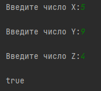

5, 9, 4 → true; 9, 1, 3 → false. *Оба исхода обработаны верно.*

*Задача 8. Возраст*

Текст задачи

*Дана сигнатура функции: String age(int x);*

*Функция возвращает строку: число x и слово «год», «года» или «лет» по
правилам:*

*«год» — если оканчивается на 1, кроме 11;*

*«года» — если оканчивается на 2, 3, 4, кроме 12, 13, 14;*

*«лет» — во всех остальных случаях.*

Пример 1: x=5 → «5 лет»

Пример 2: x=31 → «31 год»

Пример 3: x=44 → «44 года»

*Алгоритм решения*

1.  Считать число x.

2.  Найти две последние цифры (x % 100) и последнюю цифру (x % 10).

3.  Если две последние цифры от 11 до 14 — слово «лет».

4.  Иначе если последняя цифра 1 — «год».

5.  Иначе если последняя цифра 2, 3 или 4 — «года».

6.  Иначе — «лет».

7.  Вернуть строку из числа и слова.

*Тестирование*

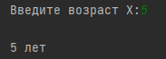

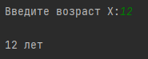

*Тесты охватывают все ветки алгоритма, включая граничные случаи:* 12 и
111 попадают в исключение «11–14», а 5 — в общий случай. Все результаты
верны.

*Задача 10. Вывод дней недели*

Текст задачи

*Дана сигнатура функции: void printDays(int x);*

*Функция принимает номер дня недели и выводит название этого дня и всех
последующих до конца недели. Если число не в диапазоне 1–7 — вывести
«это не день недели». Использовать только switch (без if).*

Пример 1: x=4 → четверг, пятница, суббота, воскресенье

Пример 2: x=18 → это не день недели

*Алгоритм решения*

1.  Считать число x.

2.  Использовать switch(x):

3.  case 1..6 — вывести день, не ставить break — программа провалится
    дальше и выведет все последующие дни.

4.  case 7 — вывести «воскресенье» и break.

5.  default — вывести «это не день недели».

Тестирование  
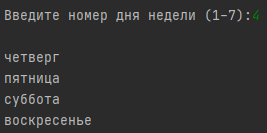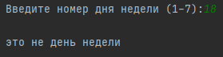

*Проверены все ветки switch:* 4 (частичный вывод), 1 (вывод с начала), 7
(только воскресенье) и 18 (default).  
**Задание 3**  
*Задача 2. Числа наоборот*

Текст задачи

*Дана сигнатура функции: String reverseListNums(int x);*

*Функция возвращает строку, в которой записаны все числа от x до 0
включительно.*

Пример: x=5 → «5 4 3 2 1 0»

*Алгоритм решения*

1.  Считать число x.

2.  Создать пустую строку.

3.  В цикле for от x до 0 (включительно) добавлять текущее число в
    строку.

4.  Между числами добавлять пробел.

5.  Вернуть полученную строку и вывести её.

*Тестирование*

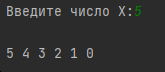

*Тесты подтверждают работу обратного цикла от x до 0 включительно.* Тест
0 проверяет граничный случай — цикл не должен пропустить ноль.

*Задача 4. Степень числа*

Текст задачи

*Дана сигнатура функции: int pow(int x, int y);*

*Функция возвращает результат возведения x в степень y.*

Пример: x=2, y=5 → 32

*Алгоритм решения*

1.  Считать x и y.

2.  Завести переменную result = 1.

3.  В цикле for от 0 до y умножать result на x.

4.  Вывести результат.

*Тестирование*

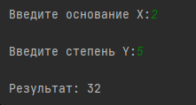

1.  2 и 5 → 32 (пример из условия).

2.  3 и 3 → 27 (нечётная степень).

3.  5 и 0 → 1 (граничный случай, любое число в степени 0 = 1).

*Задача 6. Одинаковость*

Текст задачи

*Дана сигнатура функции: bool equalNum(int x);*

*Функция возвращает true, если все знаки числа одинаковы, и false в ином
случае.*

Пример 1: x=1111 → true

Пример 2: x=1211 → false

*Алгоритм решения*

1.  Считать число x, взять модуль (на случай отрицательных).

2.  Запомнить последнюю цифру (x % 10).

3.  Отбросить её (x /= 10).

4.  В цикле while пока число \> 0: сравнивать последнюю цифру с
    запомненной. Если отличается — вернуть false.

5.  Если цикл завершился — вернуть true.

*Тестирование*

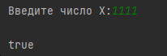

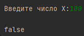

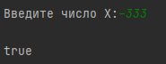

*Тесты охватывают все ветки:* одинаковые цифры, разные цифры, а также
граничные случаи — однозначное число и отрицательное значение (проверка
модуля).

*Задача 8. Левый треугольник*

Текст задачи

*Дана сигнатура функции: void leftTriangle(int x);*

*Функция выводит треугольник из символов \* высотой x. Количество
символов в ряду совпадает с номером строки.*

Пример 1:

x=2

результат:

\*

\*\*

Пример 2:

x=4

результат:

\*

\*\*

\*\*\*

\*\*\*\*

*Алгоритм решения*

1.  Считать высоту x.

2.  Внешний цикл for по строкам от 1 до x.

3.  Внутренний цикл for печатает i звёздочек.

4.  После внутреннего цикла — перевод строки.

*Тестирование*

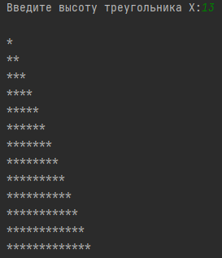

Т*есты подтверждают работу вложенных циклов:* внешний задаёт строки,
внутренний — количество звёздочек в каждой строке, равное её номеру.

*Задача 10. Угадайка*

Текст задачи

*Дана сигнатура функции: void guessGame() Необходимо реализовать функцию
таким образом, чтобы она генерировала случайное число от 0 до 9, далее
считывала с консоли введенное пользователем число и выводила, угадал ли
пользователь то, что было загадано, или нет. Функция запускается до тех
пор, пока пользователь не угадает число. После этого выведите на экран
количество попыток, которое потребовалось пользователю, чтобы угадать
число.*

Пример:

Введите число от 0 до 9:

5

Вы не угадали, введите число от 0 до 9:

9

Вы угадали!

Вы отгадали число за 2 попытки

*Алгоритм решения*

1.  Инициализировать генератор случайных чисел srand(time(0)).

2.  Сгенерировать секретное число: rand() % 10.

3.  Счётчик попыток = 0.

4.  В цикле do-while:

    -запросить число у пользователя;

    -увеличить счётчик;

    -проверить корректность (0–9);

    -сравнить с секретом, вывести результат.

5.  Повторять, пока число не совпадёт с секретом.

6.  Вывести количество попыток.

*Тестирование*

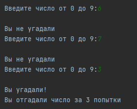

*Проверен цикл do-while:* счётчик увеличивается после каждой попытки ,
цикл завершается только при совпадении с загаданным числом.

**Задание 4**

*Задача 2. Поиск последнего значения*

Текст задачи

*Дана сигнатура функции: int findLast(int arr\[\], int x);*

*Функция возвращает индекс последнего вхождения числа x в массив arr.
Если число не входит — вернуть -1.*

Пример: arr=\[1,2,3,4,2,2,5\], x=2 → 5

*Алгоритм решения*

1.  Ввести размер массива и его элементы.

2.  Ввести число x для поиска.

3.  Пройти циклом по всему массиву, сохраняя в переменную индекс каждого
    совпадения.

4.  После цикла вернуть последний сохранённый индекс (или -1, если
    совпадений не было).

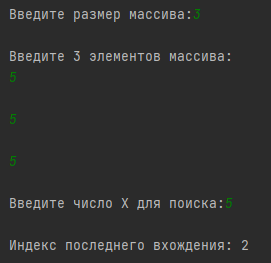

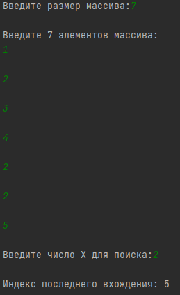Тестирование

1.  \[1,2,3,4,2,2,5\], x=2 → 5 (последнее вхождение).

2.  \[5,5,5\], x=5 → 2 (все элементы совпадают).

3.  \[1,1\], x=1 → 1 (оба элемента совпадают).

*Тесты подтверждают возврат последнего индекса:* в \[5,5,5\] функция
вернула 2 (а не 0), в \[1,1\] — 1 (а не 0).

*Задача 4. Добавление в массив*

Текст задачи

*Дана сигнатура функции: int\* add(int arr\[\], int x, int pos);*

*Функция возвращает новый массив, содержащий все элементы arr, но в
позицию pos вставлено значение x.*

Пример: arr=\[1,2,3,4,5\], x=9, pos=3 → \[1,2,3,9,4,5\]

*Алгоритм решения*

1.  Ввести массив, значение x и позицию pos.

2.  Выделить память под новый массив размером size + 1.

3.  Скопировать элементы до позиции pos.

4.  Записать x в позицию pos.

5.  Скопировать оставшиеся элементы со сдвигом на 1.

6.  Вернуть новый массив.

Тестирование

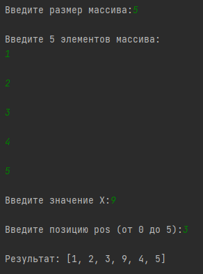

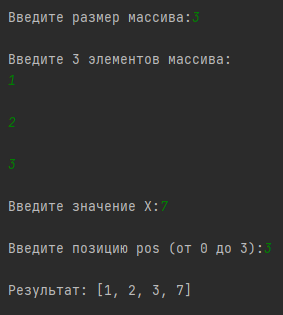

*Тесты охватывают все случаи позиции pos:* начало, середину и конец.
Размер массива корректно увеличивается на 1, элементы сдвигаются.

*Задача 6. Реверс*

Текст задачи

*Дана сигнатура функции: void reverse(int arr\[\]);*

*Функция изменяет массив arr, записывая его задом наперёд.*

Пример: arr=\[1,2,3,4,5\] → \[5,4,3,2,1\]

*Алгоритм решения*

1.  Ввести массив.

2.  Пройти циклом до середины массива.

3.  Поменять местами элемент с индексом i и элемент с индексом size -
    1 - i.

4.  Вывести изменённый массив.

*Тестирование*

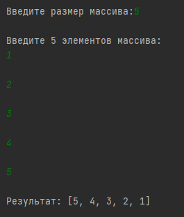

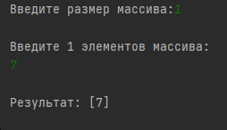

Проверены массивы из 5, 3 и 1 элемента. Реверс работает корректно,
включая граничный случай.

*Задача 8. Объединение*

Текст задачи

*Дана сигнатура функции: int\* concat(int arr1\[\], int arr2\[\]);*

*Функция возвращает новый массив, в котором сначала идут элементы arr1,
затем arr2.*

Пример: arr1=\[1,2,3\], arr2=\[7,8,9\] → \[1,2,3,7,8,9\]

*Алгоритм решения*

1.  Ввести оба массива.

2.  Выделить память под новый массив размером size1 + size2.

3.  Скопировать первый массив в начало.

4.  Скопировать второй массив после первого.

5.  Вернуть результат.

*Тестирование*

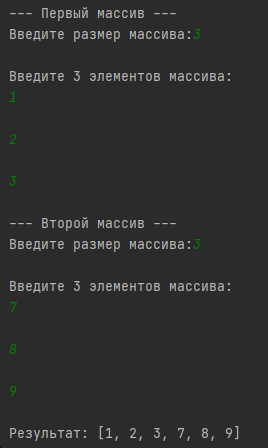

Тесты подтверждают, что элементы первого массива идут первыми, а второго
— после них. Размер результата равен сумме размеров.

*Задача 10. Удалить негатив*

Текст задачи

*Дана сигнатура функции: int\* deleteNegative(int arr\[\]);*

*Функция возвращает новый массив, в котором записаны все элементы arr,
кроме отрицательных.*

Пример: arr=\[1,2,-3,4,-2,2,-5\] → \[1,2,4,2\]

*Алгоритм решения*

1.  Ввести массив.

2.  Выделить память под новый массив такого же размера.

3.  Пройти по исходному массиву: если элемент неотрицательный — записать
    в новый массив и увеличить счётчик.

4.  Запомнить итоговое количество элементов.

5.  Вернуть новый массив.

Тестирование

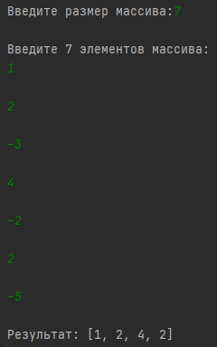

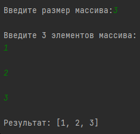  
  
  
  
  
  
  
  
  
  
Проверены случаи: смешанный массив, все отрицательные (пустой результат)
и все положительные.  
  
Ссылка на GitHub с кодом: <https://github.com/ivanyshok-coder/laba1-cpp>
